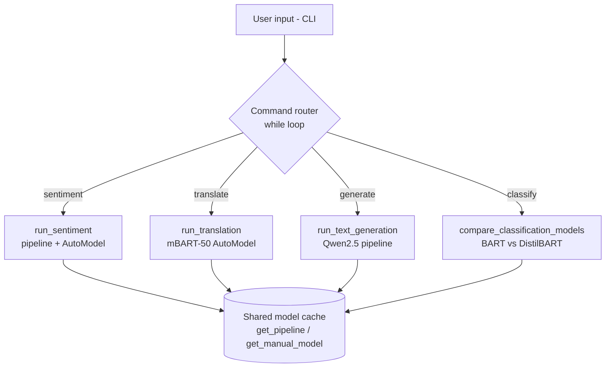
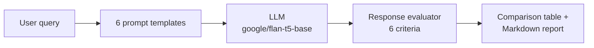

# 🤗 Hugging Face NLP Projects

Two Generative AI assignments built with **Hugging Face Transformers** and **PyTorch**, using pre-trained models only (no training or fine-tuning):

| # | Project | What it shows |
|---|---|---|
| 1.1 | 🤖 [AI Text Intelligence Assistant](#-assignment-11--ai-text-intelligence-assistant) | Four NLP tasks with `pipeline()` and manual `AutoTokenizer` + `AutoModel` inference |
| 1.2 | 🧪 [Intelligent Prompt Engineering Studio](#-assignment-12--intelligent-prompt-engineering-studio) | How six prompting strategies change an LLM's answer to the same question, with scoring |

---

## 📁 Repository Structure

```
├── HF_Model_Integration_Assignment.ipynb        # 1.1 AI Text Intelligence Assistant
├── HF_Assistant_Presentation_v2.pptx            # 1.1 presentation
├── Intelligent_Prompt_Engineering_Studio.ipynb  # 1.2 Prompt Engineering Studio
├── Intelligent_Prompt_Engineering_Studio.pptx   # 1.2 presentation
├── requirements.txt                             # Python packages for both notebooks
└── README.md
```

---

## 🤖 Assignment 1.1 – AI Text Intelligence Assistant

A command-line assistant that performs **four NLP tasks** with pre-trained Hugging Face models and reports a **confidence score** and **inference time** for every result.

### Tasks and models

| Task | Model | How it runs |
|---|---|---|
| 🙂 **Sentiment Analysis** | `cardiffnlp/twitter-roberta-base-sentiment-latest` | `pipeline()` **and** manual `AutoTokenizer` + `AutoModelForSequenceClassification`, side by side |
| 🌐 **Machine Translation** (English → Hindi, French, German, Spanish) | `facebook/mbart-large-50-many-to-many-mmt` | Manual `AutoModelForSeq2SeqLM`, beam search (4 beams) |
| ✍️ **Text Generation** | `Qwen/Qwen2.5-0.5B-Instruct` | `pipeline("text-generation")` with top-k / top-p sampling |
| 🏷️ **Zero-Shot Classification** | `facebook/bart-large-mnli` vs `valhalla/distilbart-mnli-12-3` | Two different models on the same text, compared side by side |

### Highlights

- **pipeline() vs manual inference:** sentiment runs both ways on the same model (tokenize → forward pass → softmax → argmax), so the two results can be checked against each other.
- **Two models, one task:** zero-shot classification compares a full-size model (~400M parameters) with a distilled one (~200M), showing the speed vs confidence trade-off.
- **Translation confidence:** a custom score averages the model's highest token probability over every generated step.
- **Model cache:** `get_pipeline()` and `get_manual_model()` load each model only once per session.
- **Input checks:** empty text, an unknown language or fewer than two labels return a friendly message instead of an error.
- **Interactive CLI:** a loop that lets you pick `sentiment`, `translate`, `generate`, `classify` or `quit`.

### Architecture



### Sample results (from the notebook)

| Task | Input | Result |
|---|---|---|
| Translation → Hindi | *"The invoice has been processed and sent for approval."* | बीजक प्रक्रमित किया गया है और अनुमोदन के लिए भेजा गया है। · confidence 73.23% |
| Text generation | *"The future of artificial intelligence in finance is"* | *"…bright, but it's also a complex and evolving field…"* |
| Classification | *"The quarterly earnings report showed a significant rise in revenue."* | Model A: **finance** 74.15% (6.97 s) · Model B: **finance** 51.15% (1.64 s) · ✅ models agree |

### How to use

Run all cells from top to bottom. The last cell starts the interactive assistant:

```
Which task do you want? (sentiment / translate / generate / classify / quit): translate
Enter English text to translate: Good morning, how are you?
Enter target language (Hindi/French/German/Spanish): French
```

> The first use of each model downloads it from the Hugging Face Hub (mBART-50 is about 2.4 GB, Qwen2.5-0.5B about 1 GB). After that it loads from the local cache.

---

## 🧪 Assignment 1.2 – Intelligent Prompt Engineering Studio

Sends the **same question** through **six prompting strategies** to the same model with the same settings, so any difference in the answers comes from the prompt alone. Every answer is scored and the results are exported as a Markdown comparison report.

### The six prompting strategies

| # | Strategy | Idea |
|---|---|---|
| 1 | **Zero-Shot** | Ask the question directly |
| 2 | **One-Shot** | Show one worked example first |
| 3 | **Few-Shot** | Show several examples to set a pattern |
| 4 | **Chain-of-Thought** | Ask the model to reason step by step |
| 5 | **Role-Based / Persona** | Ask the model to answer as an expert analyst |
| 6 | **Structured Output** | Force the answer into strict JSON (`answer` + `key_points`) |

### Architecture



### Model and settings

- **Model:** `google/flan-t5-base` (instruction-tuned, `text2text-generation`), running locally through Hugging Face Transformers.
- **Generation settings** (all adjustable):

| Parameter | Meaning |
|---|---|
| `temperature` | Lower = focused and repeatable, higher = more varied |
| `max_tokens` | Maximum length of the answer |
| `top_p` | Nucleus sampling – keeps only the most likely share of words |
| `top_k` | Samples only from the k most likely next words |

### Evaluation criteria

Each answer is scored **0–10** on six criteria; the **Overall Score** is their equal-weighted average.

| Criterion | How it is measured |
|---|---|
| Accuracy | How many key words from the question appear in the answer |
| Completeness | Answer length (word count) |
| Clarity | Clear connecting words (because, therefore, for example…) |
| Structure | Several sentences and transition words (first, also, however…) |
| Reasoning quality | Explanations (because, since, due to…) |
| Creativity | Words that signal a fresh angle (interestingly, notably…) |

> These scores are simple rule-based checks (heuristics), not a judgement by another AI, so treat them as a guide for comparing strategies rather than an exact measure of quality.

### How to use

1. Run the setup, model, strategy and evaluation cells.
2. In **Section 7 – Custom Query Testing**, set your own question and settings:
   ```python
   CUSTOM_QUERY = "What are renewable energy sources?"
   CUSTOM_TEMPERATURE = 0.5
   CUSTOM_MAX_TOKENS = 200
   CUSTOM_TOP_P = 0.85
   CUSTOM_TOP_K = 40
   ```
3. Run the cell. All six strategies are generated, scored and saved to **`custom_comparison_report.md`** (comparison table + every prompt, answer and score).

---

## 🚀 Setup

### Option A – Google Colab (easiest)

1. Open a notebook in [Google Colab](https://colab.research.google.com) (**File → Upload notebook**).
2. Run the cells from top to bottom. The Prompt Studio's first cell installs its packages.
3. Optional: add your Hugging Face token under **🔑 Secrets** as `HF_AK`.

### Option B – Local (VS Code / Jupyter)

```bash
git clone <repo-url>
cd <repo-folder>
python -m venv .venv
.venv\Scripts\activate          # Windows
# source .venv/bin/activate     # macOS / Linux
python -m pip install -r requirements.txt ipykernel
```

Open a notebook, select the `.venv` kernel and run the cells in order.

> **Running the Prompt Studio locally:** remove these two Colab-only lines from the model cell, because `google.colab` exists only in Colab:
> ```python
> from google.colab import userdata
> userdata.get('HF_AK')
> ```
> The models used here are public, so no token is needed.

### Requirements

```
transformers>=4.40.0
torch>=2.0.0
sentencepiece>=0.1.99
protobuf>=3.20.0
```

A GPU is optional. Everything runs on a CPU, just more slowly (larger models take several seconds per answer).

---

## 🧰 Tech Stack

| Tool | Used for |
|---|---|
| Python 3.9+ | Application logic |
| Hugging Face Transformers | `pipeline()`, `AutoTokenizer`, `AutoModelFor…` |
| PyTorch | Model inference (softmax, no-grad forward pass) |
| SentencePiece / Protobuf | Tokenizers for mBART-50 and FLAN-T5 |
| Jupyter Notebook / Google Colab | Step-by-step, interactive runs |

---

## 🔮 Possible Improvements

- A web interface (Gradio or Streamlit) for both projects
- An LLM-as-judge evaluator for the Prompt Studio instead of keyword rules
- Larger or multilingual models, and GPU acceleration
- Saving the assistant's results to a log file

---

## 👤 Author

**Akshay Kale** · Hugging Face Model Integration & Prompt Engineering assignments
